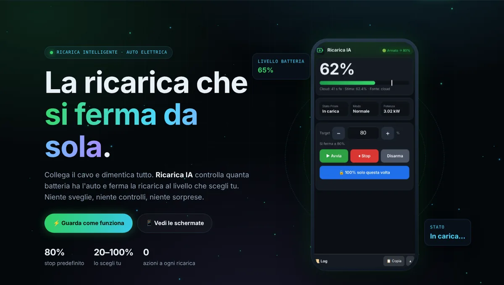
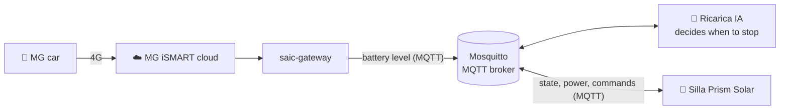
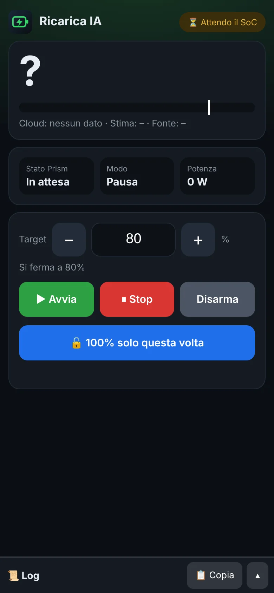
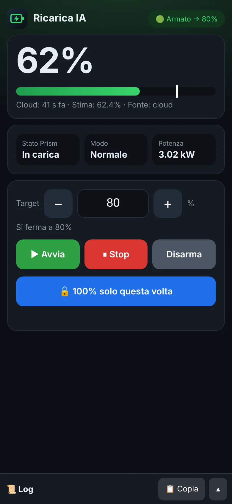
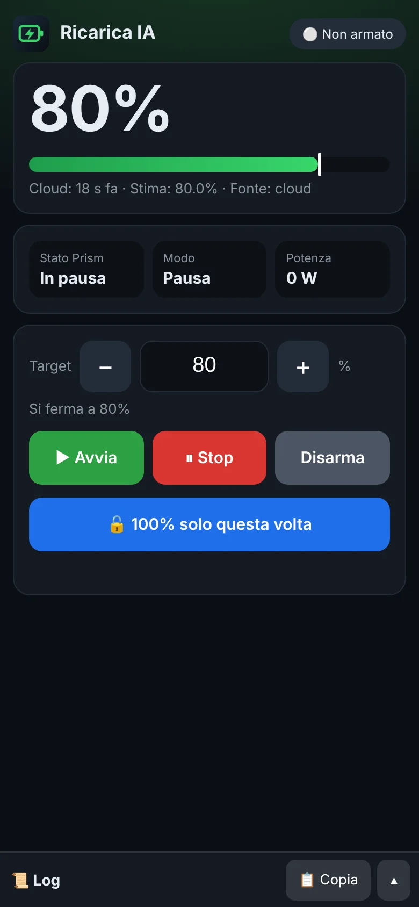
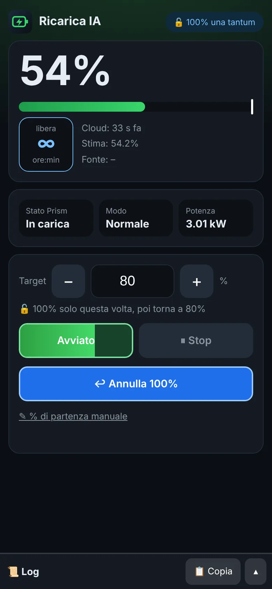
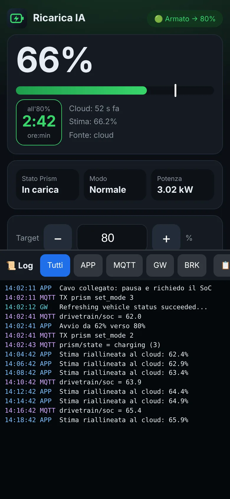

<div align="center">

[**🇮🇹 Italiano**](README.md) &nbsp;|&nbsp; **🇬🇧 English**



# ⚡ Ricarica IA

### Charging that **stops by itself**.

Plug in the cable and forget about it. **Ricarica IA** checks how full the car's battery is and stops charging at the level you choose.
No alarms, no checking, no surprises.


-4dd8ff)


**[🌐 See the presentation](https://sinapser0x.github.io/ricarica-ia/)** *(Italian)* · **[🔧 What to change](#-what-to-change)** · **[🚀 Installation](#-installation-in-5-minutes)**

</div>

> ⚠️ **The software itself is currently available in Italian only.** The documentation is bilingual (English/Italian), but the web interface (buttons, labels, messages), the screenshots and the presentation page are **only in Italian** for now. The English names of the buttons are given in parentheses throughout this guide.

---

## 🔌 Built with

> **Wallbox: Silla Prism Solar**, controlled via **MQTT** (the *custom MQTT* mode in the Silla app).
> **Car: MG4 Standard (51 kWh LFP battery)** through the MG iSMART account.
> **Home: Raspberry Pi** running Docker/Portainer, always on.

The project has been tested **only** with this combination. Other cars or wallboxes may work if they expose the same data, but they need to be adapted (see [Does it work with other hardware?](#-faq)).

| | |
|---|---|
| 🎯 **80%** | default stop level |
| 🎚️ **20–100%** | you choose |
| 👆 **0** | actions per charge: just plug in the cable |

---

## 🧭 How it works

Four steps. **It does them all.** You do one thing only: plug in the cable.

1. **🔌 You plug in the cable → immediate pause.**
   As soon as the Prism reports "waiting for car", charging is paused. This way it never starts "blind": the battery is checked first.
2. **🔋 It reads the real battery level.**
   It asks the car, through the MG cloud, how much charge it really has. If the car doesn't answer right away (underground garage, no signal), it retries with ever longer pauses, up to 10 minutes, and never gives up.
3. **▶️ Charging starts and is supervised.**
   While charging, it compares two sources: the car's own figure (cloud) and a backup calculation based on the energy delivered by the wallbox. If one is missing, it uses the other.
4. **🛑 Target reached → it stops.**
   At the chosen level (usually 80%) it pauses charging and stops querying the car. Job done.

### 🗺️ Behind the scenes, in plain words

The "brain" is a mini-computer (the Raspberry Pi) sitting in your home. You never have to touch it: it works quietly.



- 🧱 **The wallbox always talks locally.** The Prism is connected by network cable: the command channel is your home network and doesn't depend on the Internet.
- ☁️ **Only the battery reading goes through the cloud.** And only while the cable is plugged in: if you charge elsewhere, Ricarica IA does nothing and doesn't wake the car.
- 🛟 **Plan B included.** If the car's signal is missing, it carries on with an estimate based on the kWh delivered and realigns as soon as the cloud answers again.

---

## 📱 Screenshots

The interface opens from any browser on your home network and can be added to the Home screen like a real app, with its own icon. *(The images show sample data and the Italian UI.)*

<table>
  <tr>
    <td align="center"><br><b>Waiting for data</b><br><sub>Cable plugged in, charging paused</sub></td>
    <td align="center"><br><b>Supervised charging</b><br><sub>Level, source and power in real time</sub></td>
    <td align="center"><br><b>Target reached</b><br><sub>Automatic pause at 80%</sub></td>
    <td align="center"><br><b>100% just this once</b><br><sub>Free charge, then back to normal</sub></td>
    <td align="center"><br><b>The journal (log)</b><br><sub>Every move, in plain sight</sub></td>
  </tr>
</table>

---

## ✨ Features

| | Feature | What it does |
|---|---|---|
| 🎯 | **Target of your choice** | From 20% to 100% in two taps. The value is saved for future charges. |
| 🔓 | **100% just this once** | Long trip tomorrow? One button and charging runs free. When the charge ends (or the cable is unplugged) it goes back to your usual target by itself. |
| ♾️ | **Target 100% = no limit** | With the target at 100% the app doesn't intervene: the car finishes charging on its own. |
| 🧮 | **Double check** | Car data plus a backup calculation on the energy delivered: if one is missing, the other keeps the bar steady. |
| ⏳ | **Patient, not pushy** | If the car doesn't answer, it retries at growing intervals so it doesn't hammer the MG servers. |
| 🛡️ | **When in doubt, pause** | Without the battery level it won't start by itself. You can always force charging manually with **Disarma** (Disarm). |
| 🚫 | **Stays out of the way away from home** | It only acts when the car is plugged into your Prism. Elsewhere, zero interference. |
| 📲 | **Like a real app** | Add it to the iPhone Home screen with the icon and the name "Ricarica IA". Thumb-friendly interface. |
| 🔎 | **No black boxes** | The **Log** panel merges app, MQTT, gateway and broker logs. One tap copies everything so you can paste it wherever you need. |
| 🪶 | **Very lightweight** | CPU/RAM limits on the containers: it won't weigh down the Raspberry. |

---

## 🧰 What you need

- 🔌 **Silla Prism Solar** with firmware that supports **custom MQTT** (a setting in the Silla app).
- 🚗 **MG car** linked to the **MG iSMART** app.
- 👤 A dedicated **secondary MG iSMART account**, added as a user/family member (see [MG account](#-secondary-mg-account)). Don't use your main account.
- 🏠 A **Raspberry Pi** (or any always-on mini-server) with **Docker** and, optionally, **Portainer**.
- 📶 The Raspberry and the Prism on the **same local network**.

---

## 🚀 Installation in 5 minutes

### With Portainer (recommended)

1. In Portainer: **Stacks → Add stack → Web editor**.
2. Paste the contents of [`docker-compose.yml`](docker-compose.yml).
3. In the **Environment variables** section add:

   | Name | Value |
   |---|---|
   | `SAIC_USER` | email of the **secondary** MG iSMART account |
   | `SAIC_PASSWORD` | password of that account |

4. Review the values in the [What to change](#-what-to-change) section, then **Deploy the stack**.
5. Set the MQTT broker on the Prism (see [Setting up the Silla Prism](#-setting-up-the-silla-prism-mqtt)).
6. Open `http://RASPBERRY_IP:8088` from your phone. 🎉

### From the terminal

```bash
git clone https://github.com/SiNaPsEr0x/ricarica-ia.git
cd ricarica-ia
cp .env.example .env      # then edit .env with your credentials
docker compose up -d
```

> ⏱️ On **first start** the `ev-limiter` container downloads `paho-mqtt` (Internet required). After that the library stays in the `pydeps` volume.

---

## 🔧 What to change

Everything is configured in the [`docker-compose.yml`](docker-compose.yml) file. These are the places to look at, in order of importance.

### 1️⃣ Required: your MG credentials

Don't write them in the file: set them as **stack environment variables** (Portainer) or in the `.env` file (terminal).

| Variable | What to put |
|---|---|
| `SAIC_USER` | email of the secondary MG iSMART account |
| `SAIC_PASSWORD` | password of the account |

> ⚠️ The `docker-compose.yml` in this repo contains **no personal data**: `SAIC_USER` and `SAIC_PASSWORD` are `${...}` placeholders. The `.env` file is excluded from Git (`.gitignore`).

### 2️⃣ Your Prism: MQTT topic and socket

They are in the `ev-limiter` service, `environment` section.

| Variable | Example value | Meaning | When to change it |
|---|---|---|---|
| `PRISM_TOPIC` | `home/prism/` | MQTT **base topic** of the Prism | Must be **identical** to the one set in the Silla app |
| `PRISM_PORT` | `1` | Number of the wallbox **socket** (`1` or `2`) | If your car is on socket 2 |

With the example values, the app listens to and controls these topics: `home/prism/1/state`, `home/prism/1/mode`, `home/prism/1/w`, and sends commands to `home/prism/1/command/set_mode`.

### 3️⃣ Your car: battery and limit

| Variable | Default | Meaning |
|---|---|---|
| `BATTERY_KWH` | `51` | **Usable capacity** of the battery in kWh (MG4 Standard = 51). Used for the backup estimate: if it's wrong, the estimate is wrong too. |
| `TARGET_SOC` | `80` | **Initial** limit. You then change it from the web page and it stays saved. |
| `CHARGE_EFFICIENCY` | `0.92` | Charging efficiency (energy that actually reaches the battery). *Optional: not in the compose file, add it if you want to change it.* |

### 4️⃣ Behaviour (if you want to tune it)

| Variable | Default | What it does |
|---|---|---|
| `AUTO_ARM` | `true` | Arms itself as soon as you plug in the cable. With `false` you have to press **Avvia** (Start). |
| `ACQUIRE_SEC` | `300` | How long (in seconds) it waits for the battery level before switching to growing pauses. |
| `GW_OFF` | `true` | Turns off the gateway's periodic polling: the car is queried by Ricarica IA, and only while the cable is plugged in. |
| `REFRESH_SEC` | `120` | How often it asks for the level during charging (if the car doesn't answer, it stretches up to 10 minutes). *Optional.* |
| `SOC_STALE_SEC` | `600` | After how many seconds the cloud data is considered "stale". *Optional.* |
| `EST_MARGIN` | `1.0` | If the estimate exceeds the target by this many % points while the cloud is lagging, trust the estimate. *Optional.* |

*Optional* settings go in the `environment` section of the `ev-limiter` service. The maximum safety time of an armed charge is fixed at **12 hours** (the `MAX_HOURS` constant in the code).

### 5️⃣ Network and resources

| What | Where | Notes |
|---|---|---|
| Broker port **1883** | `mosquitto → ports` | If 1883 is already used on your Raspberry, change the left-hand port (e.g. `"1884:1883"`) and **use it in the Silla app too**. |
| Web page port **8088** | `ev-limiter → ports` | Change the left-hand number if it's taken. |
| Time zone `TZ` | `saic-gateway`, `ev-limiter` | Currently `Europe/Rome`: used for log timestamps. |
| `dns` | `ev-limiter` | `1.1.1.1` and `8.8.8.8` are used to download `paho-mqtt` on first start. Change them if your network blocks them. |
| `com.docker.network.driver.mtu` | `networks` | `1380` suits some low-MTU networks: if your network is normal you can **remove it**. |
| `mem_limit`, `cpus`, `pids_limit` | every service | Limits so the Raspberry doesn't get saturated. Raise them only if needed. |
| Image `saic-python-mqtt-gateway:latest` | `saic-gateway` | For stability you can pin a specific version instead of `latest`. |

---

## 📡 Setting up the Silla Prism (MQTT)

In the **Silla** app, on the unit: **⚙️ Settings → Access and communication → Custom MQTT** (menu names may vary with the app version and language).

| Field | What to enter |
|---|---|
| **Custom MQTT** | ON |
| **Host** | the **IP of your Raspberry** (not `127.0.0.1`: that would point to the Prism itself) |
| **Port** | `1883` (or the port you chose for Mosquitto) |
| **Base topic** | `home/prism/` (same as `PRISM_TOPIC`) |
| **TLS** | OFF |
| **User / Password** | anything: the stack's broker is anonymous and ignores them |

Recommended in the Silla app: **Autostart ON**. When you plug in the cable, charging may start by itself for a few seconds: Ricarica IA pauses it immediately until it knows the real battery level.

✅ **Check:** open the page `http://RASPBERRY_IP:8088`. The **Stato Prism / Modo / Potenza** (Prism state / Mode / Power) tiles must show values (not `–`). If they stay empty, open the **Log** panel, **BRK** filter: see whether the Prism has connected to the broker.

### How the Prism talks (for those who want to adapt it)

| Topic (`<base>/<socket>/…`) | Direction | Values used |
|---|---|---|
| `state` | Prism → app | `1` free · `2` waiting · `3` charging · `4` paused |
| `mode` | Prism → app | `1` solar · `2` normal · `3` pause · `4` hybrid · `5` suspended · `8` autolimit |
| `w` | Prism → app | instantaneous power in **W** |
| `command/set_mode` | app → Prism | `2` = normal (charge) · `3` = pause |

The battery level arrives from the MG gateway on `saic/<user>/vehicles/<vin>/drivetrain/soc`. The app requests an update by publishing `force` to `…/refresh/mode/set`.

---

## 👤 Secondary MG account

The gateway reads the battery level from the MG cloud using the credentials you give it. To avoid using your main account:

1. Create a **second MG iSMART account**.
2. From the main account, add it as a user/family member of the car, **permanently** (not a temporary invitation).
3. Put **that account** in `SAIC_USER` / `SAIC_PASSWORD`.

> 🩹 If the **GW** log shows `authorization revoked`, it usually means the secondary account has no (more) access to the car: check the permission again, log out of the app with that account and restart the `saic-gateway` container.

---

## 🕹️ How to use it

| Button (Italian UI) | What it does |
|---|---|
| ▶️ **Avvia** (Start) | Reads the real level (max 45 s) and starts charging towards the target. With target 100% it starts a free charge. |
| ⏸️ **Stop** | Sends pause to the Prism and disarms. |
| **Disarma** (Disarm) | Removes the limit: charging continues **without** control (useful to force it manually if the car is offline). |
| 🔓 **100% solo questa volta** (100% just this once) | Free charge for this session; then the target goes back to the usual one. |
| **− / +** | Changes the target by 5 points (20–100%), saved for future charges. |
| 📜 **Log** | Real-time journal with **APP · MQTT · GW · BRK** filters. The 📋 button copies the state and the filtered lines. |

> 💡 To force charging while the app is waiting for the level, use **Disarma** (Disarm), not the play button in the Silla app: the app would put the pause back after a few seconds.

<details>
<summary><b>HTTP API (for integrations)</b></summary>

| Method | Path | Body | Result |
|---|---|---|---|
| GET | `/api/status` | – | Full state as JSON |
| GET | `/api/logs` | – | Latest merged log lines |
| POST | `/api/start` | `{"target": 80}` | Start |
| POST | `/api/stop` | – | Pause |
| POST | `/api/disarm` | – | Disarm |
| POST | `/api/target` | `{"target": 80}` | Save the target |
| POST | `/api/once` | `{"on": true}` | Enable/cancel "100% just once" |

</details>

---

## ❓ FAQ

<details>
<summary><b>What do I have to do at each charge?</b></summary>

Just plug in the cable. Stopping the charge, checking the battery and putting everything back is done by Ricarica IA.
</details>

<details>
<summary><b>What if the car doesn't answer over the Internet?</b></summary>

Charging stays paused and the system retries at growing intervals (up to 10 minutes), with no time limit. If you're in a hurry, press **Disarma** (Disarm) and charging starts with no limit. While charging, if the data is missing, it uses the estimate based on the energy delivered and realigns when the car becomes reachable again.
</details>

<details>
<summary><b>Can I charge to 100% now and then?</b></summary>

Yes. Set the target to 100%, or use **100% solo questa volta** (100% just this once): charging runs free and, once finished or with the cable unplugged, the target goes back to normal. For LFP batteries, check what your car's manufacturer recommends about periodic 100% charges.
</details>

<details>
<summary><b>Where does my data go?</b></summary>

The logic runs in your home. The only external communication is the battery level request to the MG cloud, using your secondary account.
</details>

<details>
<summary><b>Does it work with other hardware? (other cars, other wallboxes)</b></summary>

This version is built for **MG cars + Silla Prism Solar**. The idea can be adapted to any pair that offers (1) the battery level over MQTT and (2) an MQTT pause/resume command: in practice you need to change the topics and the state values in the code inside `configs → limiter_py`.
</details>

<details>
<summary><b>What if I restart the stack during a charge?</b></summary>

After a restart the app arms itself **only** when it sees a freshly plugged-in cable. If you restart while the Prism is already charging or paused, that charge stays unlimited until you unplug and replug the cable (or press **Avvia**, Start).
</details>

---

## ⚠️ Security and known limits

- 🔓 **The web page (port 8088) has no password.** Anyone who can reach it can stop or start charging. Keep it **on the local network only**: don't expose it to the Internet. If you need it away from home, use a VPN.
- 🔓 **The Mosquitto broker is anonymous** (`allow_anonymous true`), meant for the home network. Don't publish port 1883 to the Internet.
- 🐳 `ev-limiter` mounts `/var/run/docker.sock` **read-only**, only to show the gateway and broker logs in the panel. If you don't need it, remove that line: the **GW** and **BRK** filters will show "not readable", while **APP** and **MQTT** keep working.
- 🔑 Always use a **secondary MG account**, and never put credentials inside the committed file.
- ⏳ The MG cloud can **lag** by a few minutes: that's why the backup estimate exists.
- 🧪 Tested **only** with MG4 Standard + Silla Prism Solar. No guarantees on other combinations.
- 🛟 If the Prism stays **free** even with the cable plugged in, the app can't notice by itself: press **Avvia** (Start) on the page.

---

## 📄 License and disclaimers

Released under the **MIT** license (see [`LICENSE`](LICENSE)). Use at your own risk: always check that charging stops as expected, especially the first few times.

Independent project. The names **MG, SAIC, iSMART, Silla, Prism, Raspberry Pi** belong to their respective owners; this project is **not affiliated with or endorsed** by them.
It builds on the [SAIC Python MQTT Gateway](https://github.com/SAIC-iSmart-API/saic-python-mqtt-gateway) and on [Eclipse Mosquitto](https://mosquitto.org/).
