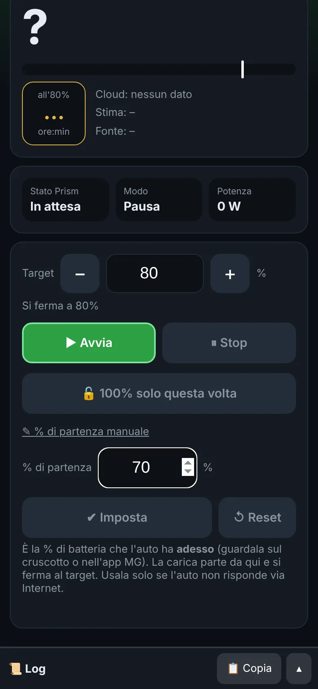
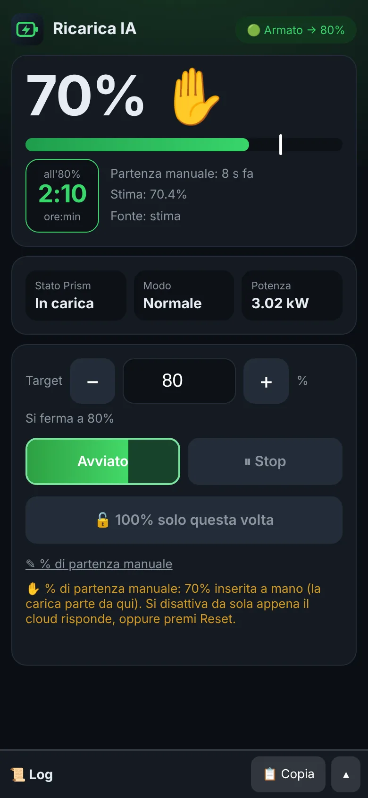

**🇮🇹 Italiano** &nbsp;|&nbsp; [**🇬🇧 English**](README.en.md)

# ⚡ Ricarica IA

### La ricarica che **si ferma da sola**.

Colleghi il cavo, lei controlla la batteria e ferma la ricarica al livello che scegli (default 80%).

**[🌐 Presentazione](https://sinapser0x.github.io/ricarica-ia/)**

> ⚠️ **Al momento il software è solo in italiano** (interfaccia web, screenshot, presentazione). La documentazione è bilingue.

## 🔌 Cosa serve

Provato **solo** con questa combinazione:

- **Wallbox** Silla Prism Solar (con MQTT personalizzato)
- **Auto** MG4 Standard, con app MG iSMART
- **Raspberry Pi** (o mini-server sempre acceso) con Docker/Portainer, sulla stessa rete della Prism
- Un **account MG iSMART secondario**, aggiunto in modo permanente come familiare dell'auto (non usare il principale)

## 🧭 Come funziona

1. Colleghi il cavo → la ricarica va subito in **pausa**.
2. Legge il **livello reale** della batteria dal cloud MG (riprova se l'auto non risponde; se proprio non risponde puoi inserire tu la **% di partenza**).
3. La ricarica parte ed è **sorvegliata** (dato dell'auto + stima di riserva sui kWh erogati).
4. Al target → **pausa automatica**.

Solo la lettura della batteria passa dal cloud, e solo a cavo inserito. I comandi alla wallbox restano in rete locale.

### 🛑 Come decide lo stop

- **Stima di riserva** = livello di partenza + kWh erogati dalla Prism × rendimento (`CHARGE_EFFICIENCY`, 0,92) ÷ capacità. Si ricalibra a ogni dato fresco del cloud.
- Si ferma quando il **dato cloud** (non più vecchio di 10 min) raggiunge il target. Se il cloud non risponde o è vecchio, decide la **stima**.
- Se il cloud è in ritardo ma la stima supera il target di `EST_MARGIN` (1 punto), vince la stima ("stima di sicurezza").
- **Sforamento massimo teorico: circa `EST_MARGIN` punti %.** A 2,8 kW la stima avanza di circa 0,2 punti ogni 2 minuti, che è l'intervallo di aggiornamento vicino al target.
- Il comando di pausa viene ripetuto finché la Prism non conferma "Pausa". Timeout di sicurezza: 12 ore.
- Aggiornamenti dal cloud: ogni 2 min a meno di 3 punti dal target, ogni 10 min più lontano; se il cloud non risponde l'intervallo raddoppia (max 10 min).
- Il tempo residuo mostrato dall'auto (riferito al 100%) **non** viene usato.

### 🔁 Presa di controllo (anche dopo un blackout)

Ricarica IA prende il comando della Prism **anche se sta già erogando corrente**:

- Se la Prism sta caricando e il limite non è armato (riavvio dello stack, blackout, carica avviata dall'app Silla), mette in **pausa**, legge il livello dal cloud e **si riarma** verso il target. Se il livello è già a target, resta in pausa.
- La sessione (armata / a target / stop / libera) e il "100% solo questa volta" sono **salvati su file** (`/deps/state.json`, volume `pydeps`) e sopravvivono al riavvio. Durante la carica salva anche la **stima del livello** ogni 30 secondi: dopo un riavvio dello stack riparte da lì (etichetta "Stima salvata") invece di perdere l'energia già erogata; solo se la sessione era armata, e scartata con Stop, fine carica o cavo scollegato.
- Lo **Stop** manuale viene rispettato anche dopo un riavvio: finché il cavo resta collegato non riprende il controllo. Scollegando il cavo si riparte da zero.
- Se la Prism stessa si riavvia e rileva di nuovo il cavo, la sessione è trattata come nuova e il limite viene applicato.
- Anti-loop: tra due prese di controllo passano almeno `TAKEOVER_COOLDOWN_SEC` secondi (120).
- Mosquitto salva i messaggi ogni 30 secondi (`autosave_interval`, il predefinito è 30 minuti): dopo un blackout i dati ripristinati sono recenti.
- Se il cloud non risponde, la carica resta in pausa finché non arriva il livello. Premendo **Avvia** parte dall'ultima lettura SoC (salvata su file, anche dopo un riavvio) e durante la carica riprende il controllo della %.
- Per tornare al comportamento precedente (arma solo al collegamento del cavo): `TAKEOVER=false`.

<table>
  <tr>
    <td align="center"></td>
    <td align="center"></td>
    <td align="center"></td>
    <td align="center"></td>
    <td align="center"></td>
    <td align="center"></td>
    <td align="center"></td>
  </tr>
</table>

## 🚀 Installazione con Portainer

1. **Stacks → Add stack** e dai un nome (es. `ricarica-ia`).
2. Scegli **Web editor** e incolla il contenuto di [`docker-compose.yml`](docker-compose.yml).
3. Sotto l'editor espandi **Environment variables** e aggiungi due variabili (una per una, oppure con **Load variables from .env file** partendo da [`.env.example`](.env.example)):
   - `SAIC_USER` = email dell'account MG iSMART **secondario**
   - `SAIC_PASSWORD` = la sua password
4. Premi **Deploy the stack**.
5. Apri `http://IP_DEL_RASPBERRY:8088` dal telefono.

Il compose legge le credenziali con `${SAIC_USER}` e `${SAIC_PASSWORD}`: lasciale così nel YAML.

> 🔐 **Non scrivere mai email e password dentro `docker-compose.yml`** e non committare il file `.env`. Se la password contiene `$` nel YAML andrebbe scritto `$$`: con le variabili di Portainer controlla il log (vedi sotto).

**Verifica:** nel log del container `saic-gateway` deve comparire `Logged in as …`.

### ✏️ Modificare o aggiornare lo stack

**Stacks → il tuo stack → Editor**: lì cambi il compose (per esempio `TARGET_SOC` o `EST_MARGIN`) ed espandi **Environment variables** per le credenziali. Poi **Update the stack**; se hai tolto dei servizi spunta anche **Prune services**. Lo stato del limiter (sessione, target) è nel volume `pydeps`.

> ⚠️ **Watchtower:** `ev-limiter` e `mosquitto` hanno la label `com.centurylinklabs.watchtower.enable: "false"`. Watchtower ricrea i container via API senza i file di `configs: content:` (`app.py`, `mosquitto.conf`): il limiter ripartirebbe in loop con `can't open file '/app/app.py'` e il limite non sarebbe applicato. Non togliere la label; per aggiornare le immagini usa **Update the stack** con **Re-pull image**.

*Alternativa Git:* **Add stack → Git Repository** con Compose path `docker-compose.yml` e le stesse variabili. Gli stack da Git non hanno la scheda Editor: per cambiare le impostazioni serve un tuo fork del repo.

*Senza Portainer* (terminale): `git clone`, `cp .env.example .env` (compila le due variabili), poi `docker compose up -d`.

## 🔧 Impostazioni principali

Nel servizio `ev-limiter` dello stack (scheda **Editor** di Portainer, oppure [`docker-compose.yml`](docker-compose.yml)):

| Variabile | Predefinito | Cosa fa |
|---|---|---|
| `PRISM_TOPIC` | `home/prism/` | Topic base MQTT, uguale a quello nell'app Silla |
| `PRISM_PORT` | `1` | Presa della wallbox (1 o 2) |
| `BATTERY_KWH` | `51` | Capacità utile della batteria |
| `TARGET_SOC` | `80` | Limite iniziale (poi si cambia dalla pagina web) |
| `AUTO_ARM` | `true` | Si arma da sola al collegamento del cavo |
| `ACQUIRE_SEC` | `300` | Quanto aspetta il livello batteria al collegamento; poi resta in pausa e riprova più lentamente |
| `REFRESH_SEC` | `120` | Secondi tra due richieste al cloud a meno di 3 punti dal target |
| `REFRESH_FAR_SEC` | `600` | Come sopra, quando il target è più lontano |
| `CHARGE_EFFICIENCY` | `0.92` | Rendimento usato dalla stima (energia in batteria ÷ energia dalla Prism) |
| `EST_MARGIN` | `1.0` | Punti % oltre il target dopo cui la stima ferma comunque la carica |
| `SOC_STALE_SEC` | `600` | Oltre questa età il dato del cloud non è più considerato fresco |
| `GW_OFF` | `true` | Spegne il polling periodico del gateway: le richieste le fa solo Ricarica IA |
| `TAKEOVER` | `true` | Prende il comando della Prism anche se sta già caricando senza limite (richiede `AUTO_ARM`) |
| `TAKEOVER_COOLDOWN_SEC` | `120` | Secondi minimi tra due prese di controllo |

Nel servizio `saic-gateway`:

| Variabile | Predefinito | Cosa fa |
|---|---|---|
| `MESSAGES_REQUEST_INTERVAL` | `900` | Secondi tra due controlli dei messaggi sull'API SAIC (il gateway di default usa 60) |

## 📡 Impostare la Prism

Nell'app **Silla**: Impostazioni → Accesso e comunicazione → **MQTT personalizzato**

- **Host:** IP del Raspberry (non `127.0.0.1`)
- **Porta:** `1883`
- **Topic base:** `home/prism/`
- **TLS:** OFF · **Utente/Password:** qualsiasi

Verifica: sulla pagina web, Stato / Modo / Potenza devono mostrare valori.

## 🌍 Da fuori casa con Tailscale

La Prism resta in rete locale e punta all'IP **LAN** del Raspberry. Il telefono, fuori casa, usa solo la pagina web:

1. Installa [Tailscale](https://tailscale.com/) sul Raspberry (sull'host, non in un container) e sul telefono.
2. Apri `http://NOME-RASPBERRY:8088` (nome MagicDNS) oppure `http://100.x.y.z:8088` (IP Tailscale).
3. Con le ACL di Tailscale limita l'accesso alla sola porta `8088` dai tuoi dispositivi: la `1883` serve solo alla Prism, in LAN.

❌ **Non usare `tailscale funnel`** e non aprire le porte sul router: Funnel espone il servizio a tutta Internet, e la pagina non ha password.

## 🕹️ Come si usa

- Il riquadro **all'80%** (ore:min) mostra il tempo stimato allo stop, calcolato dalla potenza della Prism (`--:--` se non sta caricando). Il pulsante attivo è evidenziato.
- **Avvia**: legge il livello e avvia la carica verso il target. Mentre carica il pulsante diventa **Avviato** e si riempie di verde con un'animazione, così si capisce a colpo d'occhio che sta caricando.
- **Stop**: pausa e disarma
- **✎ % di partenza manuale** (link piccolo sotto i pulsanti): scrivi la percentuale che vedi sul cruscotto o nell'app MG quando l'auto non risponde via Internet, poi **✔ Imposta**. La carica parte da quel valore e si ferma al target. Compare ✋ accanto al valore con l'avviso giallo; si disattiva da sola appena il cloud invia una lettura vera (la stima si riallinea, la carica non si interrompe). **↺ Reset** annulla subito la % manuale e torna tutto in automatico.
- **100% solo questa volta**: carica libera, poi torna al target abituale
- **− / +**: cambia il target (20–100%)
- **Log**: diario in tempo reale

## ⚠️ Attenzione

- La pagina web (porta 8088) e il broker MQTT (1883) **non hanno password**: tienili **solo in rete locale o in Tailscale**, mai su Internet.
- Il servizio `ev-limiter` monta il socket Docker (`docker.sock`) solo per mostrare i log degli altri container. Anche in sola lettura dà accesso completo a Docker sull'host: se non ti serve, togli la riga `/var/run/docker.sock` (i tab **GW** e **BRK** del log non funzioneranno).
- Se l'auto non risponde, la ricarica resta in pausa: premi **Avvia** per partire dall'ultima lettura SoC nota.
- Provato solo con MG4 Standard + Silla Prism Solar.

## 📄 Licenza

MIT, uso a tuo rischio: controlla che la ricarica si fermi come previsto. Progetto indipendente, **non affiliato** a MG, SAIC, Silla o Raspberry Pi. Si appoggia a [SAIC Python MQTT Gateway](https://github.com/SAIC-iSmart-API/saic-python-mqtt-gateway) e [Eclipse Mosquitto](https://mosquitto.org/).
