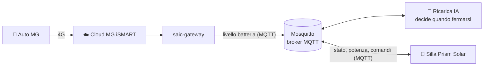
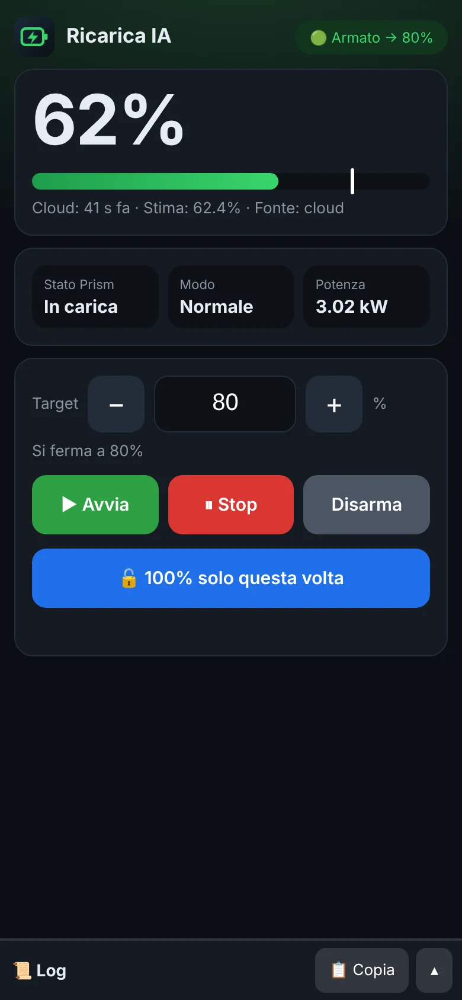

<div align="center">

**🇮🇹 Italiano** &nbsp;|&nbsp; [**🇬🇧 English**](README.en.md)


# ⚡ Ricarica IA

### La ricarica che **si ferma da sola**.

Collega il cavo e dimentica tutto. **Ricarica IA** controlla quanta batteria ha l'auto e ferma la ricarica al livello che scegli tu.
Niente sveglie, niente controlli, niente sorprese.


-4dd8ff)


**[🌐 Guarda la presentazione](https://sinapser0x.github.io/ricarica-ia/)** · **[🔧 Cosa modificare](#-cosa-modificare)** · **[🚀 Installazione](#-installazione-in-5-minuti)**

</div>

---

## 🔌 Fatto con

> **Wallbox: Silla Prism Solar**, comandata in **MQTT** (modalità *MQTT personalizzato* dell'app Silla).
> **Auto: MG4 Standard (batteria LFP da 51 kWh)** tramite l'account MG iSMART.
> **Casa: Raspberry Pi** con Docker/Portainer, sempre acceso.

Il progetto è stato provato **solo** con questa combinazione. Altre auto o wallbox potrebbero funzionare se espongono gli stessi dati, ma vanno adattate (vedi [Funziona con altro?](#-domande-frequenti)).

| | |
|---|---|
| 🎯 **80%** | stop predefinito |
| 🎚️ **20–100%** | lo scegli tu |
| 👆 **0** | azioni a ogni ricarica: basta collegare il cavo |

---

## 🧭 Come funziona

Quattro passi. **Li fa tutti lei.** Tu fai una cosa sola: colleghi il cavo.

1. **🔌 Colleghi il cavo → pausa immediata.**
   Appena la Prism segnala "in attesa dell'auto", la ricarica viene messa in pausa. Così non parte "alla cieca": prima si controlla la batteria.
2. **🔋 Legge il livello reale della batteria.**
   Chiede all'auto, tramite il cloud MG, quanta carica ha davvero. Se non risponde subito (box, garage senza campo), riprova con pause sempre più lunghe, fino a 10 minuti, senza fermarsi mai.
3. **▶️ La ricarica parte e viene sorvegliata.**
   Durante la ricarica confronta due fonti: il dato dell'auto (cloud) e un calcolo di riserva fatto sull'energia erogata dalla wallbox. Se una manca, usa l'altra.
4. **🛑 Arriva al target → si ferma.**
   Al livello scelto (di solito 80%) mette la ricarica in pausa e smette di fare richieste all'auto. Lavoro finito.

### 🗺️ Dietro le quinte, in parole semplici

Il "cervello" è un mini-computer (il Raspberry Pi) che sta in casa. Non devi toccarlo: lavora in silenzio.



- 🧱 **La wallbox parla sempre in locale.** La Prism è collegata via cavo di rete: il canale dei comandi è quello di casa, non dipende da Internet.
- ☁️ **Solo la lettura della batteria passa dal cloud.** E solo quando il cavo è inserito: se carichi altrove, Ricarica IA non fa nulla e non sveglia l'auto.
- 🛟 **Piano B incluso.** Se il segnale dell'auto manca, continua con una stima basata sui kWh erogati e si riallinea appena il cloud torna a rispondere.

---

## 📱 Le schermate

L'interfaccia si apre da qualsiasi browser della tua rete di casa e si può aggiungere alla schermata Home come una vera app, con la sua icona. *(Le immagini mostrano dati di esempio.)*

<table>
  <tr>
    <td align="center"><br><b>In attesa del dato</b><br><sub>Cavo collegato, ricarica in pausa</sub></td>
    <td align="center"><br><b>Carica sorvegliata</b><br><sub>Livello, fonte e potenza in tempo reale</sub></td>
    <td align="center"><br><b>Target raggiunto</b><br><sub>Pausa automatica all'80%</sub></td>
    <td align="center"><br><b>100% solo questa volta</b><br><sub>Carica libera, poi torna normale</sub></td>
    <td align="center"><br><b>Il diario (log)</b><br><sub>Ogni mossa, in chiaro</sub></td>
  </tr>
</table>

---

## ✨ Funzioni

| | Funzione | Cosa fa |
|---|---|---|
| 🎯 | **Target a tua scelta** | Da 20% a 100% con due tocchi. Il valore resta salvato per le prossime ricariche. |
| 🔓 | **100% solo questa volta** | Viaggio lungo domani? Un tasto e la carica va libera. A fine ricarica (o a cavo scollegato) torna da solo al tuo target abituale. |
| ♾️ | **Target 100% = nessun limite** | Con il target a 100% l'app non interviene: la carica la termina l'auto da sola. |
| 🧮 | **Doppia verifica** | Dato dell'auto più calcolo di riserva sull'energia erogata: se uno dei due manca, l'altro tiene la barra dritta. |
| ⏳ | **Paziente, non insistente** | Se l'auto non risponde, riprova a intervalli crescenti per non martellare i server MG. |
| 🛡️ | **Nel dubbio, pausa** | Senza il livello della batteria non parte da sola. Puoi sempre forzare la ricarica a mano con **Disarma**. |
| 🚫 | **Non disturba fuori casa** | Entra in gioco solo quando l'auto è collegata alla tua Prism. Altrove, zero interferenze. |
| 📲 | **Come una vera app** | Si aggiunge alla Home dell'iPhone con icona e nome "Ricarica IA". Interfaccia pensata per il pollice. |
| 🔎 | **Niente scatole nere** | Il pannello **Log** unisce app, MQTT, gateway e broker. Con un tocco copi tutto e lo incolli dove ti serve. |
| 🪶 | **Leggerissima** | Limiti di CPU/RAM sui container: non appesantisce il Raspberry. |

---

## 🧰 Cosa serve

- 🔌 **Silla Prism Solar** con firmware che supporta **MQTT personalizzato** (impostazione nell'app Silla).
- 🚗 **Auto MG** collegata all'app **MG iSMART**.
- 👤 Un **account MG iSMART secondario** dedicato, aggiunto come utente/familiare (vedi [Account MG](#-account-mg-secondario)). Non usare il tuo account principale.
- 🏠 Un **Raspberry Pi** (o qualunque mini-server sempre acceso) con **Docker** e, se vuoi, **Portainer**.
- 📶 Il Raspberry e la Prism sulla **stessa rete locale**.

---

## 🚀 Installazione in 5 minuti

### Con Portainer (consigliato)

1. In Portainer: **Stacks → Add stack → Web editor**.
2. Incolla il contenuto di [`docker-compose.yml`](docker-compose.yml).
3. Nella sezione **Environment variables** aggiungi:

   | Nome | Valore |
   |---|---|
   | `SAIC_USER` | email dell'account MG iSMART **secondario** |
   | `SAIC_PASSWORD` | password di quell'account |

4. Rivedi i valori nella sezione [Cosa modificare](#-cosa-modificare), poi **Deploy the stack**.
5. Imposta il broker MQTT sulla Prism (vedi [Impostare la Silla Prism](#-impostare-la-silla-prism-mqtt)).
6. Apri `http://IP_DEL_RASPBERRY:8088` dal telefono. 🎉

### Da terminale

```bash
git clone https://github.com/SiNaPsEr0x/ricarica-ia.git
cd ricarica-ia
cp .env.example .env      # poi modifica .env con le tue credenziali
docker compose up -d
```

> ⏱️ Al **primo avvio** il container `ev-limiter` scarica `paho-mqtt` (serve Internet). Poi la libreria resta nel volume `pydeps`.

---

## 🔧 Cosa modificare

Tutto si regola nel file [`docker-compose.yml`](docker-compose.yml). Questi sono i punti da guardare, in ordine di importanza.

### 1️⃣ Obbligatorio: le tue credenziali MG

Non scriverle nel file: mettile come **variabili d'ambiente dello stack** (Portainer) o nel file `.env` (terminale).

| Variabile | Cosa metterci |
|---|---|
| `SAIC_USER` | email dell'account MG iSMART secondario |
| `SAIC_PASSWORD` | password dell'account |

> ⚠️ Nel `docker-compose.yml` di questa repo **non ci sono dati personali**: `SAIC_USER` e `SAIC_PASSWORD` sono segnaposto `${...}`. Il file `.env` è escluso da Git (`.gitignore`).

### 2️⃣ La tua Prism: topic MQTT e presa

Sono nel servizio `ev-limiter`, sezione `environment`.

| Variabile | Valore di esempio | Cosa significa | Quando cambiarla |
|---|---|---|---|
| `PRISM_TOPIC` | `home/prism/` | **Topic base** MQTT della Prism | Deve essere **identico** a quello impostato nell'app Silla |
| `PRISM_PORT` | `1` | Numero della **presa** della wallbox (`1` o `2`) | Se la tua auto è sulla presa 2 |

Con i valori di esempio, l'app ascolta e comanda questi topic: `home/prism/1/state`, `home/prism/1/mode`, `home/prism/1/w` e invia i comandi su `home/prism/1/command/set_mode`.

### 3️⃣ La tua auto: batteria e limite

| Variabile | Predefinito | Cosa significa |
|---|---|---|
| `BATTERY_KWH` | `51` | **Capacità utile** della batteria in kWh (MG4 Standard = 51). Serve per la stima di riserva: se è sbagliata, sbaglia anche la stima. |
| `TARGET_SOC` | `80` | Limite **iniziale**. Poi lo cambi dalla pagina web e resta salvato. |
| `CHARGE_EFFICIENCY` | `0.92` | Rendimento della ricarica (energia che arriva davvero in batteria). *Opzionale: non è nel compose, aggiungila se vuoi cambiarla.* |

### 4️⃣ Il comportamento (se vuoi regolarlo)

| Variabile | Predefinito | Cosa fa |
|---|---|---|
| `AUTO_ARM` | `true` | Appena colleghi il cavo si arma da sola. Con `false` devi premere **Avvia**. |
| `ACQUIRE_SEC` | `300` | Quanto aspetta (in secondi) il livello della batteria prima di passare alle pause crescenti. |
| `GW_OFF` | `true` | Spegne il polling periodico del gateway: l'auto viene interrogata da Ricarica IA, e solo a cavo inserito. |
| `REFRESH_SEC` | `120` | Ogni quanto chiede il livello durante la ricarica (se non risponde, allunga fino a 10 minuti). *Opzionale.* |
| `SOC_STALE_SEC` | `600` | Dopo quanti secondi il dato del cloud è considerato "vecchio". *Opzionale.* |
| `EST_MARGIN` | `1.0` | Se la stima supera il target di questi punti % mentre il cloud è in ritardo, fidarsi della stima. *Opzionale.* |

Le opzioni *opzionali* vanno aggiunte nella sezione `environment` del servizio `ev-limiter`. Il tempo massimo di sicurezza di una carica armata è fisso a **12 ore** (costante `MAX_HOURS` nel codice).

### 5️⃣ Rete e risorse

| Cosa | Dove | Note |
|---|---|---|
| Porta **1883** del broker | `mosquitto → ports` | Se la 1883 è già usata sul tuo Raspberry, cambia la porta a sinistra (es. `"1884:1883"`) e **usala anche nell'app Silla**. |
| Porta **8088** della pagina web | `ev-limiter → ports` | Cambia il numero a sinistra se è occupata. |
| Fuso orario `TZ` | `saic-gateway`, `ev-limiter` | Ora `Europe/Rome`: per l'orario dei log. |
| `dns` | `ev-limiter` | `1.1.1.1` e `8.8.8.8` servono a scaricare `paho-mqtt` al primo avvio. Cambiali se la tua rete li blocca. |
| `com.docker.network.driver.mtu` | `networks` | `1380` è un valore adatto a certe reti con MTU basso: se la tua rete è normale puoi **toglierlo**. |
| `mem_limit`, `cpus`, `pids_limit` | ogni servizio | Limiti per non saturare il Raspberry. Alzali solo se serve. |
| Immagine `saic-python-mqtt-gateway:latest` | `saic-gateway` | Per stabilità puoi fissare una versione precisa al posto di `latest`. |

---

## 📡 Impostare la Silla Prism (MQTT)

Nell'app **Silla**, sul box: **⚙️ Impostazioni → Accesso e comunicazione → MQTT personalizzato** (i nomi dei menu possono variare con la versione dell'app).

| Campo | Cosa mettere |
|---|---|
| **MQTT personalizzato** | ON |
| **Host** | l'**IP del tuo Raspberry** (non `127.0.0.1`: punterebbe alla Prism stessa) |
| **Porta** | `1883` (o la porta che hai scelto per Mosquitto) |
| **Topic base** | `home/prism/` (lo stesso di `PRISM_TOPIC`) |
| **TLS** | OFF |
| **Utente / Password** | qualsiasi: il broker dello stack è anonimo e li ignora |

Consigliato nell'app Silla: **Autostart ON**. Quando colleghi il cavo la ricarica può partire per qualche secondo da sola: Ricarica IA la mette subito in pausa finché non conosce il livello reale della batteria.

✅ **Verifica:** apri la pagina `http://IP_DEL_RASPBERRY:8088`. I riquadri **Stato Prism / Modo / Potenza** devono mostrare dei valori (non `–`). Se restano vuoti, apri il pannello **Log**, filtro **BRK**: guarda se la Prism si è collegata al broker.

### Come parla la Prism (per chi vuole adattarlo)

| Topic (`<base>/<presa>/…`) | Direzione | Valori usati |
|---|---|---|
| `state` | Prism → app | `1` libera · `2` in attesa · `3` in carica · `4` in pausa |
| `mode` | Prism → app | `1` solare · `2` normale · `3` pausa · `4` ibrido · `5` sospeso · `8` autolimit |
| `w` | Prism → app | potenza istantanea in **W** |
| `command/set_mode` | app → Prism | `2` = normale (carica) · `3` = pausa |

Dal gateway MG arriva il livello batteria su `saic/<utente>/vehicles/<vin>/drivetrain/soc`. L'app chiede un aggiornamento pubblicando `force` su `…/refresh/mode/set`.

---

## 👤 Account MG secondario

Il gateway legge il livello batteria dal cloud MG con le credenziali che gli dai. Per non usare il tuo account principale:

1. Crea un **secondo account MG iSMART**.
2. Dall'account principale aggiungilo come utente/familiare dell'auto, in modo **permanente** (non un invito temporaneo).
3. Metti **quell'account** in `SAIC_USER` / `SAIC_PASSWORD`.

> 🩹 Se nel log **GW** compare `authorization revoked`, di solito significa che l'account secondario non ha (più) accesso all'auto: ricontrolla l'abilitazione, esci dall'app con quell'account e riavvia il container `saic-gateway`.

---

## 🕹️ Come si usa

| Pulsante | Cosa fa |
|---|---|
| ▶️ **Avvia** | Legge il livello reale (max 45 s) e avvia la carica verso il target. Con target 100% avvia una carica libera. |
| ⏸️ **Stop** | Manda la pausa alla Prism e disarma. |
| **Disarma** | Toglie il limite: la carica continua **senza** controllo (utile per forzarla a mano se l'auto è offline). |
| 🔓 **100% solo questa volta** | Carica libera per questa sessione; poi il target torna a quello abituale. |
| **− / +** | Cambia il target di 5 punti (20–100%), salvato per le prossime ricariche. |
| 📜 **Log** | Diario in tempo reale con filtri **APP · MQTT · GW · BRK**. Il pulsante 📋 copia lo stato e le righe filtrate. |

> 💡 Per forzare la carica mentre l'app aspetta il livello, usa **Disarma**, non il tasto play dell'app Silla: l'app rimetterebbe la pausa dopo pochi secondi.

<details>
<summary><b>API HTTP (per integrazioni)</b></summary>

| Metodo | Percorso | Corpo | Risultato |
|---|---|---|---|
| GET | `/api/status` | – | Stato completo in JSON |
| GET | `/api/logs` | – | Ultime righe di log unite |
| POST | `/api/start` | `{"target": 80}` | Avvia |
| POST | `/api/stop` | – | Pausa |
| POST | `/api/disarm` | – | Disarma |
| POST | `/api/target` | `{"target": 80}` | Salva il target |
| POST | `/api/once` | `{"on": true}` | Attiva/annulla "100% una tantum" |

</details>

---

## ❓ Domande frequenti

<details>
<summary><b>Cosa devo fare a ogni ricarica?</b></summary>

Solo collegare il cavo. Fermare la ricarica, controllare la batteria e rimettere tutto a posto lo fa Ricarica IA.
</details>

<details>
<summary><b>E se l'auto non risponde via Internet?</b></summary>

La ricarica resta in pausa e il sistema riprova a intervalli crescenti (fino a 10 minuti), senza limite di tempo. Se hai fretta, premi **Disarma** e la carica parte senza limite. Durante la ricarica, se il dato manca, usa la stima sull'energia erogata e si riallinea quando l'auto torna raggiungibile.
</details>

<details>
<summary><b>Posso caricare al 100% ogni tanto?</b></summary>

Sì. Imposti il target a 100%, oppure usi **100% solo questa volta**: la carica va libera e, finita o a cavo scollegato, il target torna a quello normale. Per le batterie LFP controlla cosa consiglia il costruttore della tua auto sul 100% periodico.
</details>

<details>
<summary><b>I miei dati dove finiscono?</b></summary>

La logica gira in casa tua. L'unica comunicazione esterna è la richiesta del livello batteria al cloud MG, con il tuo account secondario.
</details>

<details>
<summary><b>Funziona con altro? (altre auto, altre wallbox)</b></summary>

Questa versione è pensata per **auto MG + Silla Prism Solar**. L'idea è adattabile a qualunque coppia che offra (1) il livello batteria in MQTT e (2) un comando MQTT di pausa/ripresa: in pratica vanno cambiati i topic e i valori di stato nel codice dentro `configs → limiter_py`.
</details>

<details>
<summary><b>Se riavvio lo stack durante una carica?</b></summary>

Dopo un riavvio l'app si arma **solo** quando vede il cavo appena collegato. Se riavvii mentre la Prism è già in carica o in pausa, quella carica resta senza limite finché non scolleghi e ricolleghi il cavo (oppure premi **Avvia**).
</details>

---

## ⚠️ Sicurezza e limiti noti

- 🔓 **La pagina web (porta 8088) non ha password.** Chi la raggiunge può fermare o avviare la ricarica. Tienila **solo in rete locale**: non esporla su Internet. Se ti serve da fuori casa, usa una VPN.
- 🔓 **Il broker Mosquitto è anonimo** (`allow_anonymous true`), pensato per la rete di casa. Non pubblicare la porta 1883 su Internet.
- 🐳 `ev-limiter` monta `/var/run/docker.sock` **in sola lettura**, solo per mostrare i log di gateway e broker nel pannello. Se non ti serve, togli quella riga: i filtri **GW** e **BRK** del pannello mostreranno "non leggibile", mentre **APP** e **MQTT** continuano a funzionare.
- 🔑 Usa sempre un **account MG secondario**, e non mettere mai le credenziali dentro il file committato.
- ⏳ Il cloud MG può essere **in ritardo** di qualche minuto: è il motivo per cui esiste la stima di riserva.
- 🧪 Provato **solo** con MG4 Standard + Silla Prism Solar. Nessuna garanzia su altre combinazioni.
- 🛟 Se la Prism resta **libera** anche con il cavo inserito, l'app non può accorgersene da sola: premi **Avvia** dalla pagina.

---

## 📄 Licenza e avvertenze

Rilasciato con licenza **MIT** (vedi [`LICENSE`](LICENSE)). Uso a tuo rischio: controlla sempre che la ricarica si fermi come previsto, soprattutto le prime volte.

Progetto indipendente. I nomi **MG, SAIC, iSMART, Silla, Prism, Raspberry Pi** appartengono ai rispettivi proprietari; questo progetto **non è affiliato né approvato** da essi.
Si appoggia al [SAIC Python MQTT Gateway](https://github.com/SAIC-iSmart-API/saic-python-mqtt-gateway) e a [Eclipse Mosquitto](https://mosquitto.org/).
