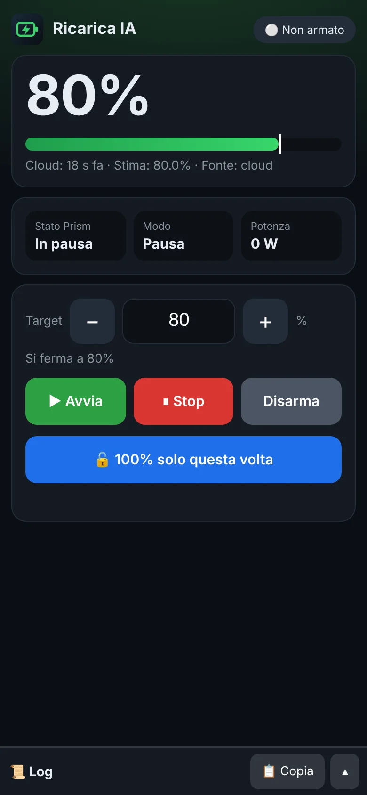
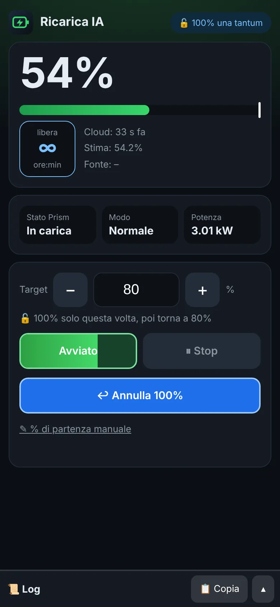

<div align="center">

**🇮🇹 Italiano** &nbsp;|&nbsp; [**🇬🇧 English**](README.en.md)


# ⚡ Ricarica IA

### La ricarica che **si ferma da sola**.

Colleghi il cavo, lei controlla la batteria e ferma la ricarica al livello che scegli (default 80%).


**[🌐 Presentazione](https://sinapser0x.github.io/ricarica-ia/)**

</div>

> ⚠️ **Al momento il software è solo in italiano** (interfaccia web, screenshot, presentazione). La documentazione è bilingue.

## 🔌 Cosa serve

Provato **solo** con questa combinazione:

- **Wallbox** Silla Prism Solar (con MQTT personalizzato)
- **Auto** MG4 Standard, con app MG iSMART
- **Raspberry Pi** (o mini-server sempre acceso) con Docker/Portainer, sulla stessa rete della Prism
- Un **account MG iSMART secondario**, aggiunto in modo permanente come familiare dell'auto (non usare il principale)

## 🧭 Come funziona

1. Colleghi il cavo → la ricarica va subito in **pausa**.
2. Legge il **livello reale** della batteria dal cloud MG (riprova se l'auto non risponde).
3. La ricarica parte ed è **sorvegliata** (dato dell'auto + stima di riserva sui kWh erogati).
4. Al target → **pausa automatica**.

Solo la lettura della batteria passa dal cloud, e solo a cavo inserito. I comandi alla wallbox restano in rete locale.

<table>
  <tr>
    <td align="center"></td>
    <td align="center"></td>
    <td align="center"></td>
    <td align="center"></td>
    <td align="center"></td>
  </tr>
</table>

## 🚀 Installazione

```bash
git clone https://github.com/SiNaPsEr0x/ricarica-ia.git
cd ricarica-ia
cp .env.example .env      # inserisci SAIC_USER e SAIC_PASSWORD (account MG secondario)
docker compose up -d
```

Con Portainer: **Stacks → Add stack**, incolla [`docker-compose.yml`](docker-compose.yml) e aggiungi `SAIC_USER` e `SAIC_PASSWORD` come variabili d'ambiente.

Poi apri `http://IP_DEL_RASPBERRY:8088` dal telefono.

## 🔧 Impostazioni principali

Nel servizio `ev-limiter` di [`docker-compose.yml`](docker-compose.yml):

| Variabile | Predefinito | Cosa fa |
|---|---|---|
| `PRISM_TOPIC` | `home/prism/` | Topic base MQTT, uguale a quello nell'app Silla |
| `PRISM_PORT` | `1` | Presa della wallbox (1 o 2) |
| `BATTERY_KWH` | `51` | Capacità utile della batteria |
| `TARGET_SOC` | `80` | Limite iniziale (poi si cambia dalla pagina web) |
| `AUTO_ARM` | `true` | Si arma da sola al collegamento del cavo |

## 📡 Impostare la Prism

Nell'app **Silla**: Impostazioni → Accesso e comunicazione → **MQTT personalizzato**

- **Host:** IP del Raspberry (non `127.0.0.1`)
- **Porta:** `1883`
- **Topic base:** `home/prism/`
- **TLS:** OFF · **Utente/Password:** qualsiasi

Verifica: sulla pagina web, Stato / Modo / Potenza devono mostrare valori.

## 🕹️ Come si usa

- **Avvia**: legge il livello e avvia la carica verso il target
- **Stop**: pausa e disarma
- **Disarma**: toglie il limite, la carica continua libera
- **100% solo questa volta**: carica libera, poi torna al target abituale
- **− / +**: cambia il target (20–100%)
- **Log**: diario in tempo reale

## ⚠️ Attenzione

- La pagina web (porta 8088) e il broker MQTT (1883) **non hanno password**: tienili **solo in rete locale**, mai su Internet.
- Se l'auto non risponde, la ricarica resta in pausa: premi **Disarma** per forzarla.
- Provato solo con MG4 Standard + Silla Prism Solar.

## 📄 Licenza

MIT, uso a tuo rischio: controlla che la ricarica si fermi come previsto. Progetto indipendente, **non affiliato** a MG, SAIC, Silla o Raspberry Pi. Si appoggia a [SAIC Python MQTT Gateway](https://github.com/SAIC-iSmart-API/saic-python-mqtt-gateway) e [Eclipse Mosquitto](https://mosquitto.org/).
