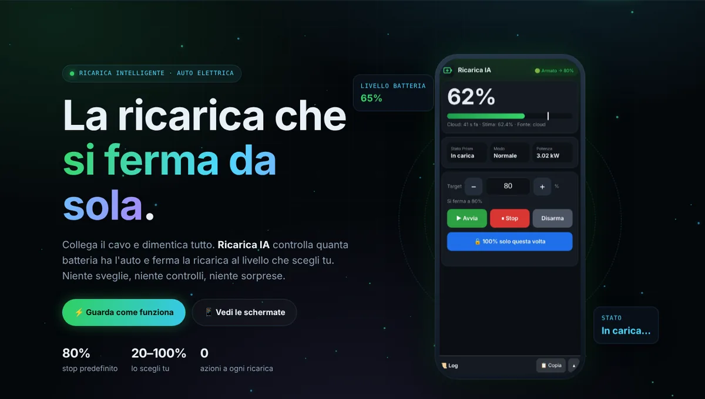
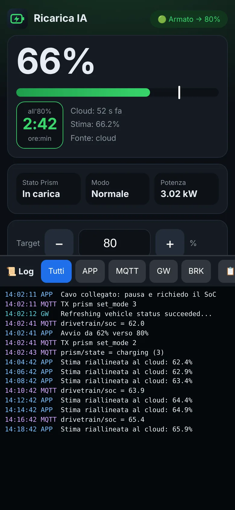

<div align="center">

**🇮🇹 Italiano** &nbsp;|&nbsp; [**🇬🇧 English**](README.en.md)



# ⚡ Ricarica IA

### La ricarica che **si ferma da sola**.

Colleghi il cavo, lei controlla la batteria e ferma la ricarica al livello che scegli (default 80%).


**[🌐 Presentazione](https://sinapser0x.github.io/ricarica-ia/)**

</div>

> ⚠️ **Al momento il software è solo in italiano** (interfaccia web, screenshot, presentazione). La documentazione è bilingue.

## 🔌 Cosa serve

Provato **solo** con questa combinazione:

- **Wallbox** Silla Prism Solar (con MQTT personalizzato)
- **Auto** MG4 Standard, con app MG iSMART
- **Raspberry Pi** (o mini-server sempre acceso) con Docker/Portainer, sulla stessa rete della Prism
- Un **account MG iSMART secondario**, aggiunto in modo permanente come familiare dell'auto (non usare il principale)

## 🧭 Come funziona

1. Colleghi il cavo → la ricarica va subito in **pausa**.
2. Legge il **livello reale** della batteria dal cloud MG (riprova se l'auto non risponde).
3. La ricarica parte ed è **sorvegliata** (dato dell'auto + stima di riserva sui kWh erogati).
4. Al target → **pausa automatica**.

Solo la lettura della batteria passa dal cloud, e solo a cavo inserito. I comandi alla wallbox restano in rete locale.

### 🛑 Come decide lo stop

- **Stima di riserva** = livello di partenza + kWh erogati dalla Prism × rendimento (`CHARGE_EFFICIENCY`, 0,92) ÷ capacità. Si ricalibra a ogni dato fresco del cloud.
- Si ferma quando il **dato cloud** (non più vecchio di 10 min) raggiunge il target. Se il cloud non risponde o è vecchio, decide la **stima**.
- Se il cloud è in ritardo ma la stima supera il target di `EST_MARGIN` (1 punto), vince la stima ("stima di sicurezza").
- **Sforamento massimo teorico: circa `EST_MARGIN` punti %.** A 2,8 kW la stima avanza di circa 0,2 punti ogni 2 minuti, che è l'intervallo di aggiornamento vicino al target.
- Il comando di pausa viene ripetuto finché la Prism non conferma "Pausa". Timeout di sicurezza: 12 ore.
- Aggiornamenti dal cloud: ogni 2 min a meno di 3 punti dal target, ogni 10 min più lontano; se il cloud non risponde l'intervallo raddoppia (max 10 min).
- Il tempo residuo mostrato dall'auto (riferito al 100%) **non** viene usato.

<table>
  <tr>
    <td align="center"></td>
    <td align="center"></td>
    <td align="center"></td>
    <td align="center"></td>
    <td align="center"></td>
  </tr>
</table>

## 🚀 Installazione

```bash
git clone https://github.com/SiNaPsEr0x/ricarica-ia.git
cd ricarica-ia
cp .env.example .env      # inserisci SAIC_USER e SAIC_PASSWORD (account MG secondario)
docker compose up -d
```

Con Portainer: **Stacks → Add stack**, incolla [`docker-compose.yml`](docker-compose.yml) e aggiungi `SAIC_USER` e `SAIC_PASSWORD` come variabili d'ambiente dello stack.

> 🔐 **Non scrivere mai email e password dentro `docker-compose.yml`** e non committare il file `.env`: se pubblichi un tuo fork, controlla con `git diff` prima del push.

Poi apri `http://IP_DEL_RASPBERRY:8088` dal telefono.

## 🔧 Impostazioni principali

Nel servizio `ev-limiter` di [`docker-compose.yml`](docker-compose.yml):

| Variabile | Predefinito | Cosa fa |
|---|---|---|
| `PRISM_TOPIC` | `home/prism/` | Topic base MQTT, uguale a quello nell'app Silla |
| `PRISM_PORT` | `1` | Presa della wallbox (1 o 2) |
| `BATTERY_KWH` | `51` | Capacità utile della batteria |
| `TARGET_SOC` | `80` | Limite iniziale (poi si cambia dalla pagina web) |
| `AUTO_ARM` | `true` | Si arma da sola al collegamento del cavo |
| `ACQUIRE_SEC` | `300` | Quanto aspetta il livello batteria al collegamento; poi resta in pausa e riprova più lentamente |
| `REFRESH_SEC` | `120` | Secondi tra due richieste al cloud a meno di 3 punti dal target |
| `REFRESH_FAR_SEC` | `600` | Come sopra, quando il target è più lontano |
| `CHARGE_EFFICIENCY` | `0.92` | Rendimento usato dalla stima (energia in batteria ÷ energia dalla Prism) |
| `EST_MARGIN` | `1.0` | Punti % oltre il target dopo cui la stima ferma comunque la carica |
| `SOC_STALE_SEC` | `600` | Oltre questa età il dato del cloud non è più considerato fresco |
| `GW_OFF` | `true` | Spegne il polling periodico del gateway: le richieste le fa solo Ricarica IA |

Nel servizio `saic-gateway`:

| Variabile | Predefinito | Cosa fa |
|---|---|---|
| `MESSAGES_REQUEST_INTERVAL` | `900` | Secondi tra due controlli dei messaggi sull'API SAIC (il gateway di default usa 60) |

## 📡 Impostare la Prism

Nell'app **Silla**: Impostazioni → Accesso e comunicazione → **MQTT personalizzato**

- **Host:** IP del Raspberry (non `127.0.0.1`)
- **Porta:** `1883`
- **Topic base:** `home/prism/`
- **TLS:** OFF · **Utente/Password:** qualsiasi

Verifica: sulla pagina web, Stato / Modo / Potenza devono mostrare valori.

## 🌍 Da fuori casa con Tailscale

La Prism resta in rete locale e punta all'IP **LAN** del Raspberry. Il telefono, fuori casa, usa solo la pagina web:

1. Installa [Tailscale](https://tailscale.com/) sul Raspberry (sull'host, non in un container) e sul telefono.
2. Apri `http://NOME-RASPBERRY:8088` (nome MagicDNS) oppure `http://100.x.y.z:8088` (IP Tailscale).
3. Con le ACL di Tailscale limita l'accesso alla sola porta `8088` dai tuoi dispositivi: la `1883` serve solo alla Prism, in LAN.

❌ **Non usare `tailscale funnel`** e non aprire le porte sul router: Funnel espone il servizio a tutta Internet, e la pagina non ha password.

## 🕹️ Come si usa

- Il riquadro **all'80%** (ore:min) mostra il tempo stimato allo stop, calcolato dalla potenza della Prism (`--:--` se non sta caricando). Il pulsante attivo è evidenziato.
- **Avvia**: legge il livello e avvia la carica verso il target
- **Stop**: pausa e disarma
- **Disarma**: toglie il limite, la carica continua libera
- **100% solo questa volta**: carica libera, poi torna al target abituale
- **− / +**: cambia il target (20–100%)
- **Log**: diario in tempo reale

## ⚠️ Attenzione

- La pagina web (porta 8088) e il broker MQTT (1883) **non hanno password**: tienili **solo in rete locale o in Tailscale**, mai su Internet.
- Il servizio `ev-limiter` monta il socket Docker (`docker.sock`) solo per mostrare i log degli altri container. Anche in sola lettura dà accesso completo a Docker sull'host: se non ti serve, togli la riga `/var/run/docker.sock` (i tab **GW** e **BRK** del log non funzioneranno).
- Se l'auto non risponde, la ricarica resta in pausa: premi **Disarma** per forzarla.
- Provato solo con MG4 Standard + Silla Prism Solar.

## 📄 Licenza

MIT, uso a tuo rischio: controlla che la ricarica si fermi come previsto. Progetto indipendente, **non affiliato** a MG, SAIC, Silla o Raspberry Pi. Si appoggia a [SAIC Python MQTT Gateway](https://github.com/SAIC-iSmart-API/saic-python-mqtt-gateway) e [Eclipse Mosquitto](https://mosquitto.org/).
